# Windows Transfer Tool

A staged, menu-driven PowerShell tool that moves a Windows user's files, apps and settings from an **old PC** to a **new PC** over the local network. No extra software, no cloud: it uses SMB, `robocopy`, `reg.exe` and `winget`.

> **Status: untested draft.** Preview with a dry run first, and keep the old PC until you have checked the new one.

## Quick start

On **both** PCs, open PowerShell (Start, type `powershell`, Enter) and paste:

```powershell
irm https://raw.githubusercontent.com/OWNER/windows-transfer-tool/main/bootstrap.ps1 | iex
```

The bootstrap asks whether the PC is the **old** one (source) or the **new** one (destination), requests administrator rights, downloads the tool and starts it. Do the old PC first: it shows its IP address and a **pairing code**. Enter both on the new PC, choose what to transfer, and the two PCs proceed on their own. The old PC reverts its sharing changes when the new PC reports it is done.

To preview on the new PC without changing anything:

```powershell
$env:WTT_DRYRUN='1'; irm https://raw.githubusercontent.com/OWNER/windows-transfer-tool/main/bootstrap.ps1 | iex
```

Offline alternative: copy the folder to both PCs and double-click `Start-Migration.cmd`, or from an elevated PowerShell run `.\Migrate-Windows.ps1 -Mode Source` / `-Mode Destination`.

> Replace `OWNER` with the GitHub account that hosts this repository. Until then, set `$env:WTT_REPO='you/windows-transfer-tool'` before the one-liner.

## The process at a glance

```mermaid
flowchart LR
    B(("bootstrap.ps1<br/>irm ... | iex"))

    subgraph OLD["OLD PC - source"]
        direction TB
        S1["S1 Preflight<br/>admin, right user, OneDrive check"] --> S2["S2 Export<br/>registry, Wi-Fi, app list, wallpaper"]
        S2 --> S3["S3 Open sharing<br/>firewall, network profile, admin share"]
        S3 --> S4["S4 Pair<br/>show IP + pairing code, wait"]
        S4 --> S5["S5 Wait<br/>until the new PC is done"]
        S5 --> S6["S6 Cleanup<br/>revert sharing, delete export"]
    end

    subgraph NEW["NEW PC - destination"]
        direction TB
        D1["D1 Preflight<br/>admin, right user, winget"] --> D2["D2 Bind<br/>IP, login, pairing code"]
        D2 --> D3["D3 Select<br/>checkbox menu"]
        D3 --> D4["D4 Files<br/>robocopy personal folders"]
        D4 --> D5["D5 Apps<br/>winget, app data"]
        D5 --> D6["D6 Settings<br/>registry, Explorer restart"]
        D6 --> D7["D7 Finish<br/>summary, notify old PC"]
    end

    B -.-> S1
    B -.-> D1
    S4 -. "pairing code (on screen)" .-> D2
    D2 -. "bound.json" .-> S4
    D7 -. "done.json" .-> S5
```



Each stage code is printed on screen and in the logs, so a problem can be reported as "failed in D6". Detailed graphs of every stage, the binding handshake and the sharing state machine are in [docs/process.md](docs/process.md).

## What it can transfer

Pick any combination from a checkbox menu. Items run in three stages on the new PC: files first, then apps, then settings, so Explorer is only restarted at the very end.

| Stage | Group | Items |
|---|---|---|
| D4 Files | Personal files | Desktop, Documents, Pictures, Videos, Music, Downloads, Favorites/Links/Contacts/Saved Games/Searches (OneDrive-redirected folders are followed) |
| D5 Apps | Apps and app data | Reinstall apps via winget (+ CSV of everything installed) *(off by default)*, browser bookmarks, Windows Terminal, VS Code settings and extensions, `.gitconfig` / `.ssh` / `.aws` / `.kube` *(off by default)*, Office signatures and templates, Sticky Notes |
| D6 Settings | Windows settings | Theme, dark mode, accent colors, cursors, wallpaper; taskbar, Start menu, Quick Access and File Explorer options; desktop icon positions; mouse/touchpad/keyboard/sounds/accessibility; language and regional formats; user environment variables; mapped drives and printers; per-user fonts; Wi-Fi networks; power plan *(off by default)* |

Menu keys: Up/Down move, Space toggle, G toggle group, A all, N none, Enter start, Q quit.

## Binding the two PCs

Stage S4 on the old PC writes a salted hash of a random six-digit code into the export and shows the code on screen. Stage D2 on the new PC connects with the old PC's Windows login, checks the code against the hash, and writes a `bound.json` marker back. The old PC then **restricts its firewall rules to the new PC's address**, so for the rest of the transfer no other machine can reach the sharing ports. When the new PC finishes it writes `done.json`, and the old PC reverts everything. The code is a confirmation that you are talking to the right machine, not a secret: the Windows password is still what grants access.

## Options

`bootstrap.ps1` reads these environment variables; `Migrate-Windows.ps1` takes the switches directly.

| Env var (bootstrap) | Switch (script) | Side | Purpose |
|---|---|---|---|
| `WTT_ROLE=Source\|Destination\|Download` | `-Mode Source\|Destination` | both | Skip the role question. `Download` only fetches the tool |
| `WTT_DRYRUN=1` | `-DryRun` | new | Show what would be copied; change nothing |
| `WTT_REF=<tag or sha>` | | both | Pin a version instead of `main` |
| `WTT_REPO=<owner/repo>` | | both | Use a fork |
| | `-OldPCIP <ip>` | new | Skip the IP prompt |
| | `-PairCode 123456` | new | Skip the pairing-code prompt |
| | `-Select All` / `-Select f_docs,s_taskbar` | new | Skip the menu (item keys are in the `$Catalog` at the top of the script) |
| | `-Yes` | new | No "Proceed?" / "clean up?" / "sign out?" questions |
| | `-Threads <n>` | new | robocopy threads (default 8; Wi-Fi rarely benefits from more) |
| | `-InitCredentials` | new | Generate `credentials.json` (below) |
| | `-NoSave` | new | Never offer to save credentials |
| | `-Cleanup` | old | Revert sharing and delete the export if stage S6 never ran |

## Credentials file

To avoid retyping the old PC's address and login, the tool can generate a local `credentials.json`:

```powershell
.\Migrate-Windows.ps1 -InitCredentials
```

It also offers to create it after the first successful connection. The file looks like [credentials.example.json](credentials.example.json):

- The password is encrypted with **Windows DPAPI**: only the same Windows user on the same PC can decrypt it.
- The file's permissions are restricted to your user, and it is in `.gitignore`. **Never commit it, and never paste real values into the example file.**
- If it goes stale (password changed), delete it and re-run.

## Caveats and doing it by hand

- [docs/caveats.md](docs/caveats.md): what the tool cannot do or does imperfectly, why, and the manual workaround for each.
- [docs/manual.md](docs/manual.md): how to perform every item by hand, including opening and reverting the sharing yourself.

The short version: saved browser passwords, Windows Credential Manager entries and default-app choices cannot be moved; taskbar pins only work for apps that are installed at the same path; the user `Path` variable and taskbar pins are not rewritten when the user name differs; display scaling is deliberately not copied; the old PC's admin share is exposed to the LAN between stages S3 and S4.

## Security notes

- Stage S3 enables the "File and Printer Sharing" firewall group, marks Public networks Private, and sets `LocalAccountTokenFilterPolicy=1` so the admin share accepts a local account. Stage S4 then limits those firewall rules to the new PC's IP. Everything is recorded and restored in S6 (or by `-Cleanup`).
- The Wi-Fi export contains passwords in clear text inside `C:\MigrationExport` on the old PC until cleanup removes it.
- The developer-config item copies private keys (`.ssh`, `.aws`, ...). It is off by default.
- Passwords are never put on a command line; the SMB connection is made in-process.
- `irm | iex` runs whatever the URL serves. Pin a tag with `WTT_REF` or read `bootstrap.ps1` first if that matters to you.

## Contributing

Issues and pull requests are welcome. Keep the script ASCII-only so it also runs on Windows PowerShell 5.1, and keep the Mermaid diagrams in `docs/` in step with the stage codes.

## License

[MIT](LICENSE)
