# Windows Transfer Tool

A staged, menu-driven PowerShell tool that moves a Windows user's files, apps and settings from an **old PC** to a **new PC** over the local network. No extra software, no cloud. The new PC reaches the old one over **FTPS** (default), plain **FTP**, or **SMB**; settings travel as `reg.exe` exports and apps come back through `winget`.

> **Branch `ftp-ftps`.** The one-liners below download this branch's files, not `main`'s (`bootstrap.ps1` defaults `WTT_REF` to `ftp-ftps`). The FTP/FTPS transport and the script around it are tested on loopback in Windows PowerShell 5.1 and PowerShell 7, including a real third-party client (curl). **Not yet exercised: the Windows firewall rule and a run between two real PCs.** Preview with a dry run first, and keep the old PC until you have checked the new one.

## Quick start

On **both** PCs, open PowerShell (Start, type `powershell`, Enter) and paste:

```powershell
Set-ExecutionPolicy Bypass -Scope Process -Force
irm https://raw.githubusercontent.com/SheepasTech/windows-transfer-tool/ftp-ftps/bootstrap.ps1 | iex
```

`-Scope Process` lifts the script policy for this PowerShell window only. It is not saved and reverts when you close the window.

The bootstrap asks whether the PC is the **old** one (source) or the **new** one (destination), requests administrator rights, downloads the tool and starts it. Do the old PC first. It asks how the new PC should connect (Enter = FTPS), exports its settings, starts a small read-only service and shows:

- its **IP address** and **port**,
- a six-digit **pairing code**,
- a one-time **password** (`XXXX-XXXX-XXXX-XXXX`),
- for FTPS, the certificate **fingerprint**.

On the new PC the tool detects the service by itself, shows the fingerprint it sees (confirm that it matches the old PC's screen), asks for the password and the pairing code, and then you choose what to transfer. No Windows account of any kind is involved in FTPS or FTP. The service is removed again when the old PC cleans up at the end.

To preview on the new PC without changing anything:

```powershell
Set-ExecutionPolicy Bypass -Scope Process -Force
$env:WTT_DRYRUN='1'; irm https://raw.githubusercontent.com/SheepasTech/windows-transfer-tool/ftp-ftps/bootstrap.ps1 | iex
```

Offline alternative: copy the **whole folder** (the `lib` folder is needed for FTP/FTPS) to both PCs and double-click `Start-Migration.cmd`, or from an elevated PowerShell run `.\Migrate-Windows.ps1 -Mode Source` / `-Mode Destination`.

## How the new PC reaches the old one

Chosen on the old PC (`-Transport`, or the question in the bootstrap). The new PC needs no setting: it looks for the FTP service first and falls back to SMB.

| | **FTPS** (default) | **FTP** | **SMB** |
|---|---|---|---|
| Encrypted | yes, TLS with a self-signed certificate | no | only if Windows negotiates SMB 3 encryption (it is always signed) |
| Sign-in | random one-time password | random one-time password | temporary local administrator account (or your own with `-UseOwnAccount`) |
| Windows account involved | none | none | yes, a temporary one |
| Changes on the old PC | one firewall rule for port 2121 and a passive range, a service inside the PowerShell window | same | firewall group, network profile, `LocalAccountTokenFilterPolicy`, a local account |
| Access | read-only, locks after 5 wrong passwords, restricted to the bound address | same | admin share |
| Copy engine on the new PC | built-in FTP mirror (several connections) | same | `robocopy` |
| Use it when | almost always | a LAN you fully trust and TLS gives trouble | FTP ports are blocked or you want `robocopy` |

The FTP service is a small server in [lib/WttFtp.cs](lib/WttFtp.cs), compiled when the tool starts. It speaks ordinary FTP, so Explorer, WinSCP, FileZilla or `curl` can also connect to it by hand ([docs/manual.md](docs/manual.md#using-the-ftp-service-by-hand)).

## The process at a glance

```mermaid
flowchart LR
    B(("bootstrap.ps1<br/>irm ... | iex"))

    subgraph OLD["OLD PC - source"]
        direction TB
        S1["S1 Preflight<br/>admin, right user, OneDrive check"] --> S2["S2 Export<br/>registry, Wi-Fi, app list, wallpaper"]
        S2 --> S3["S3 Start the service<br/>FTPS/FTP server + firewall rule<br/>(SMB: open sharing + temp account)"]
        S3 --> S4["S4 Pair<br/>show IP, pairing code, password, fingerprint, wait"]
        S4 --> S5["S5 Wait<br/>until the new PC is done"]
        S5 --> S6["S6 Cleanup<br/>stop service, remove rule, delete export"]
    end

    subgraph NEW["NEW PC - destination"]
        direction TB
        D1["D1 Preflight<br/>admin, right user, winget"] --> D2["D2 Bind<br/>detect transport, check fingerprint,<br/>password, pairing code"]
        D2 --> D3["D3 Select<br/>checkbox menu"]
        D3 --> D4["D4 Files<br/>FTP mirror or robocopy"]
        D4 --> D5["D5 Apps<br/>winget, app data"]
        D5 --> D6["D6 Settings<br/>registry, Explorer restart"]
        D6 --> D7["D7 Finish<br/>summary, notify old PC"]
    end

    B -.-> S1
    B -.-> D1
    S4 -. "code + password + fingerprint (on screen)" .-> D2
    D2 -. "bound.json" .-> S4
    D7 -. "done.json" .-> S5
```



Each stage code is printed on screen and in the logs, so a problem can be reported as "failed in D6". Detailed graphs of every stage, the binding handshake, the FTP service and the SMB sharing state are in [docs/process.md](docs/process.md).

## What it can transfer

Pick any combination from a checkbox menu. Items run in three stages on the new PC: files first, then apps, then settings, so Explorer is only restarted at the very end.

| Stage | Group | Items |
|---|---|---|
| D4 Files | Personal files | Desktop, Documents, Pictures, Videos, Music, Downloads, Favorites/Links/Contacts/Saved Games/Searches (OneDrive-redirected folders are followed) |
| D5 Apps | Apps and app data | Reinstall apps via winget (+ CSV of everything installed) *(off by default)*, browser bookmarks, Windows Terminal, VS Code settings and extensions, `.gitconfig` / `.ssh` / `.aws` / `.kube` *(off by default)*, Office signatures and templates, Sticky Notes |
| D6 Settings | Windows settings | Theme, dark mode, accent colors, cursors, wallpaper; taskbar, Start menu, Quick Access and File Explorer options; desktop icon positions; mouse/touchpad/keyboard/sounds/accessibility; language and regional formats; user environment variables; mapped drives and printers; per-user fonts; Wi-Fi networks; power plan *(off by default)* |

Menu keys: Up/Down move, Space toggle, G toggle group, A all, N none, Enter start, Q quit.

## Binding the two PCs

Stage S4 on the old PC writes a salted hash of a random six-digit code into the export and shows the code on screen. Stage D2 on the new PC signs in (FTP/FTPS password, or the temporary SMB account), fetches the small export package, checks the code against the hash, and writes a `bound.json` marker back. The old PC then **restricts the service to the new PC's address** (FTP/FTPS: the server and its firewall rule; SMB: the sharing firewall rules). When the new PC finishes it writes `done.json`, and the old PC reverts everything. The code is a confirmation that you are talking to the right machine, not a secret: the password is what grants access.

With FTPS the new PC also **pins the server certificate**. The certificate is self-signed and created fresh for each run, so there is no authority to trust. Instead the new PC shows its SHA-256 fingerprint before any password is sent, you compare it with the old PC's screen, and from then on only that exact certificate is accepted. Pass `-Fingerprint` (or `WTT_FINGERPRINT`) to skip the question.

## Options

`bootstrap.ps1` reads these environment variables; `Migrate-Windows.ps1` takes the switches directly.

| Env var (bootstrap) | Switch (script) | Side | Purpose |
|---|---|---|---|
| `WTT_ROLE=Source\|Destination\|Download` | `-Mode Source\|Destination` | both | Skip the role question. `Download` only fetches the tool |
| `WTT_TRANSPORT=Ftps\|Ftp\|Smb` | `-Transport Auto\|Ftps\|Ftp\|Smb` | old | How the new PC connects (default FTPS). On the new PC leave it at `Auto`: it detects what the old PC offers |
| `WTT_FTPPORT=2121` | `-FtpPort <n>` | both | Control port of the FTP(S) service. Change it on both PCs if 2121 is taken |
| `WTT_FINGERPRINT=<hex>` | `-Fingerprint <hex>` | new | FTPS: expected certificate fingerprint (first 32+ hex digits, any spacing) instead of confirming by eye |
| `WTT_DRYRUN=1` | `-DryRun` | new | Show what would be copied; change nothing |
| `WTT_REF=<branch, tag or sha>` | | both | Pin a version instead of `ftp-ftps` |
| `WTT_REPO=<owner/repo>` | | both | Use a fork |
| | `-OldPCIP <ip>` | new | Skip the IP prompt |
| | `-PairCode 123456` | new | Skip the pairing-code prompt |
| | `-Select All` / `-Select f_docs,s_taskbar` | new | Skip the menu (item keys are in the `$Catalog` at the top of the script) |
| | `-Yes` | new | No "Proceed?" / "clean up?" / "sign out?" questions |
| | `-Threads <n>` | new | Parallel copy streams (default 8; Wi-Fi rarely benefits from more) |
| | `-UseOwnAccount` | old, SMB | Sign in with your own Windows account instead of a temporary one |
| | `-InitCredentials`, `-NoSave` | new, SMB | Generate / never offer `credentials.json` (below) |
| | `-Cleanup` | old | Stop the service or revert sharing and delete the export if stage S6 never ran |

## Credentials file (SMB only)

FTP and FTPS passwords are random for every run, so there is nothing worth saving. For SMB with your own account (`-UseOwnAccount`) the tool can keep the old PC's address and login in a local `credentials.json`:

```powershell
.\Migrate-Windows.ps1 -InitCredentials
```

It also offers to create it after the first successful SMB connection, unless you signed in with the default temporary account (deleted at the end of the run). The file looks like [credentials.example.json](credentials.example.json):

- The password is encrypted with **Windows DPAPI**: only the same Windows user on the same PC can decrypt it.
- The file's permissions are restricted to your user, and it is in `.gitignore`. **Never commit it, and never paste real values into the example file.**
- If it goes stale (password changed, or it was from a temporary account that has since been deleted), delete it and re-run.

## Caveats and doing it by hand

- [docs/caveats.md](docs/caveats.md): what the tool cannot do or does imperfectly, why, and the manual workaround for each.
- [docs/manual.md](docs/manual.md): how to perform every item by hand, including using the FTP service from any FTP client and opening and reverting SMB sharing yourself.

The short version: saved browser passwords, Windows Credential Manager entries and default-app choices cannot be moved; taskbar pins only work for apps that are installed at the same path; the user `Path` variable and taskbar pins are not rewritten when the user name differs; display scaling is deliberately not copied; over FTP/FTPS file attributes, ACLs and folder timestamps are not copied (file contents and modified times are); both PCs must be on the same subnet and the old PC's service port must be free.

## Security notes

- **FTPS / FTP:** the service is read-only, serves only the export folder, the user profile and the redirected known folders, does not follow directory junctions or symbolic links, hides its own state file, and accepts uploads of exactly two small marker files. It listens on one control port plus a passive range (default 2121 and 52100-52150), opened by a firewall rule limited to the local subnet and narrowed to the new PC's address once it has bound. The password is 80 random bits, a wrong one is delayed, and five wrong ones lock the service. With plain FTP none of this is encrypted: use FTPS unless you fully trust the network.
- **SMB:** by default stage S3 creates a disposable local administrator account (random name, 24-character password), hidden from the sign-in screen and deleted in S6, and enables the "File and Printer Sharing" firewall group, marks Public networks Private and sets `LocalAccountTokenFilterPolicy=1`. All of it is restored in S6 or by `-Cleanup`. `-UseOwnAccount` signs in with a real account instead.
- The Wi-Fi export contains passwords in clear text inside `C:\MigrationExport` on the old PC until cleanup removes it. On the new PC over FTP/FTPS the export package is held in a private temporary folder for the duration of the run and deleted afterwards.
- The developer-config item copies private keys (`.ssh`, `.aws`, ...). It is off by default.
- Passwords are never put on a command line; connections are made in-process.
- `irm | iex` runs whatever the URL serves. Pin a tag or commit with `WTT_REF`, or read `bootstrap.ps1` first, if that matters to you.

## Contributing

Issues and pull requests are welcome. Keep `Migrate-Windows.ps1` ASCII-only so it also runs on Windows PowerShell 5.1, keep `lib/WttFtp.cs` ASCII-only and C# 5 compatible (the old compiler behind Add-Type), and keep the Mermaid diagrams in `docs/` in step with the stage codes.

## License

[MIT](LICENSE)
