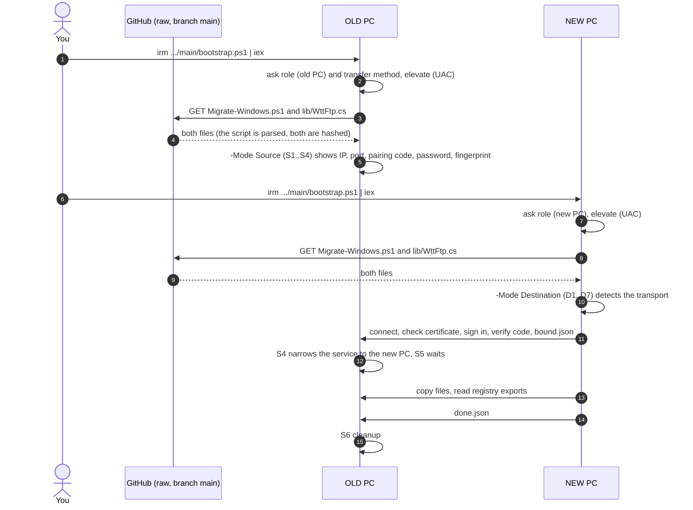
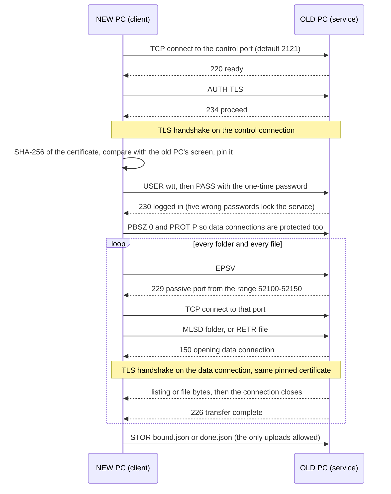
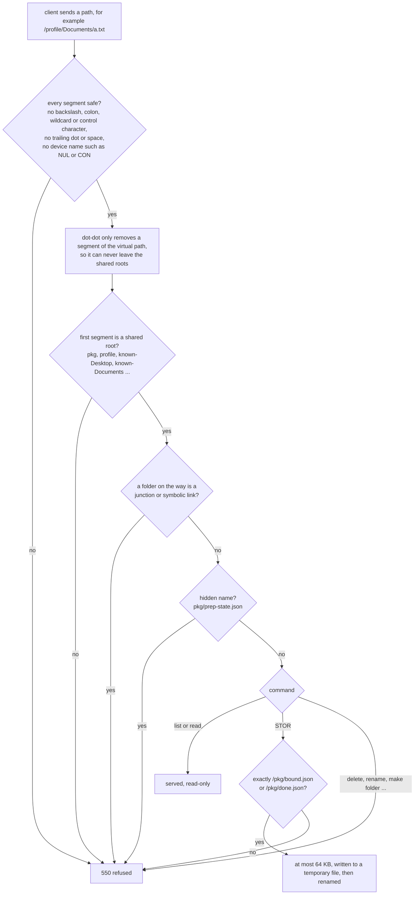
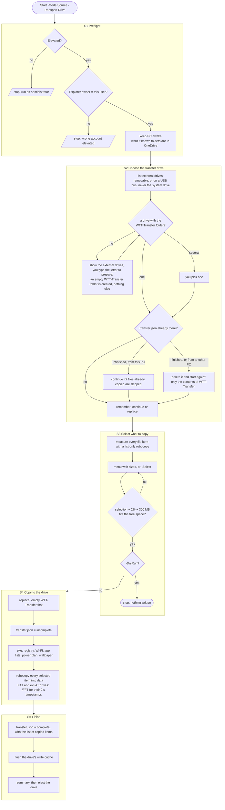
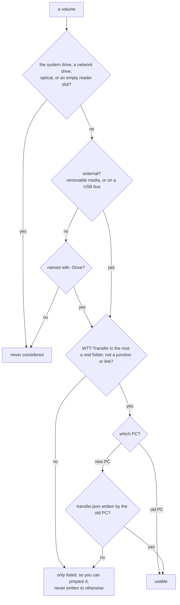
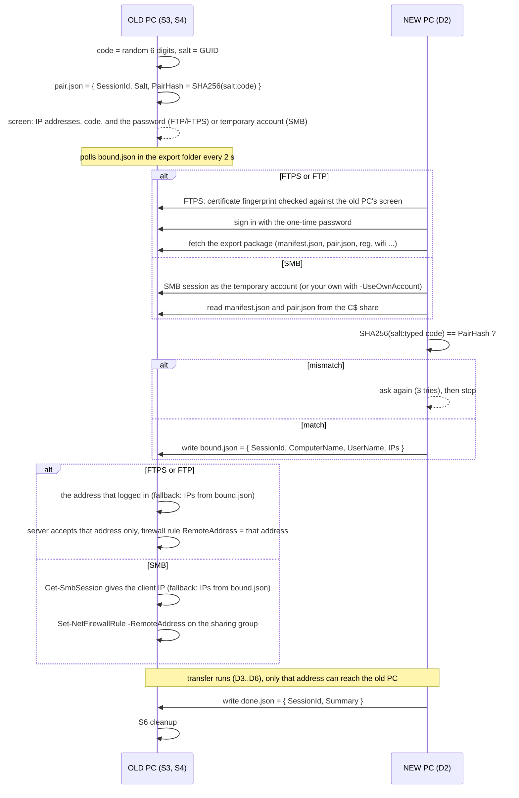
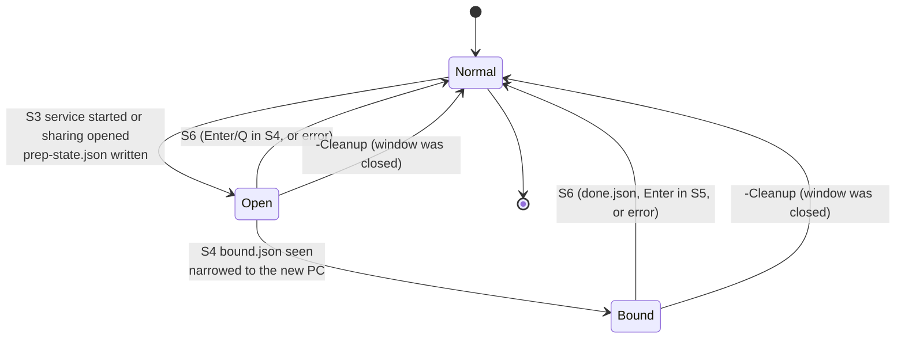

# Process

The tool is two cooperating programs: `Migrate-Windows.ps1 -Mode Source` on the old PC and `-Mode Destination` on the new PC, both normally started by `bootstrap.ps1`. Each side is a fixed sequence of stages. The stage code (S1..S6, D1..D7) is printed on screen and written to the transcript log, so problems can be pinned to a stage.

There are four ways for the data to reach the new PC, chosen on the old PC: **FTPS** (default), **FTP**, **SMB** and **Drive**. The three network ways share the stages below and only differ inside S3, S4, D2, D4 and S6. The drive way has its own, shorter old-PC stages ([S1 to S5 for a drive](#the-flash-drive-or-external-ssd-transport)) and joins the new-PC stages at D2.

- [Getting the tool onto both PCs](#getting-the-tool-onto-both-pcs)
- [Old PC stages](#old-pc-stages)
- [The FTP and FTPS service](#the-ftp-and-ftps-service)
- [The temporary account (SMB)](#the-temporary-account-smb)
- [The flash drive or external SSD transport](#the-flash-drive-or-external-ssd-transport)
- [New PC stages](#new-pc-stages)
- [Binding handshake](#binding-handshake)
- [State on the old PC](#state-on-the-old-pc)
- [Files produced](#files-produced)

## Getting the tool onto both PCs



The diagram shows the network ways. `bootstrap.ps1` only needs the network to fetch the tool; the two copies of `Migrate-Windows.ps1` then talk to each other directly. Nothing is uploaded anywhere. With a drive the two PCs never talk: the old PC writes to the drive, you carry it, the new PC reads it. Both PCs need `lib/WttFtp.cs` next to the script for FTP and FTPS (the bootstrap downloads it; for an offline copy take the whole folder).

## Old PC stages

```mermaid
flowchart TD
    A([Start -Mode Source]) --> S1
    subgraph S1["S1 Preflight"]
        direction TB
        P1{"Elevated?"} -- no --> X1[/"stop: run as administrator"/]
        P1 -- yes --> P2{"Explorer owner = this user?"}
        P2 -- no --> X2[/"stop: wrong account elevated"/]
        P2 -- yes --> P3["keep PC awake<br/>warn if known folders are in OneDrive"]
    end
    P3 --> S2
    subgraph S2["S2 Export to the MigrationExport folder on C:"]
        direction TB
        E1["manifest.json: user, profile path, known folders, OS"]
        E2["reg folder: one .reg file per registry key, per catalog item"]
        E3["wifi folder: one .xml per network (key=clear)"]
        E4["apps-report.csv, apps.json (winget), vscode-extensions.txt"]
        E5["power.pow, wallpaper file"]
        E1 --> E2 --> E3 --> E4 --> E5
    end
    E5 --> S3
    subgraph S3["S3 Open the way in (recorded in prep-state.json first)"]
        direction TB
        T0{"transport"} -- "Ftps or Ftp" --> T1["Ftps: self-signed certificate, made in memory<br/>random 16-character password (80 bits)"]
        T1 --> T2["prep-state.json notes the transport and the firewall rule name"]
        T2 --> T3["inbound firewall rule: control port and passive range,<br/>local subnet only"]
        T3 --> T4["start the read-only server inside this PowerShell window"]
        T0 -- "Smb" --> H0{"-UseOwnAccount?"}
        H0 -- no --> H0a["create temporary local admin account<br/>random name + 24-char password"]
        H0 -- yes --> H1
        H0a --> H1["start Server service if stopped"] --> H2["enable firewall group<br/>File and Printer Sharing"]
        H2 --> H3["Public networks -> Private"] --> H4["LocalAccountTokenFilterPolicy = 1"]
    end
    T4 --> S4
    H4 --> S4
    subgraph S4["S4 Pair"]
        direction TB
        R1["pair.json: salt + SHA256(salt:code)"] --> R2["show IP addresses and the 6-digit code<br/>Ftps/Ftp: port, password, fingerprint (Ftps)<br/>Smb: temporary account name and password"]
        R2 --> R3{"bound.json with<br/>matching SessionId?"}
        R3 -- "Enter / Q" --> CANCEL["cancelled"]
        R3 -- yes --> R4["client address:<br/>Ftps/Ftp: the address that logged in<br/>Smb: the SMB session"] --> R5["narrow to that address:<br/>Ftps/Ftp: server + firewall rule<br/>Smb: sharing firewall rules"]
    end
    R5 --> S5
    subgraph S5["S5 Wait"]
        W1{"done.json?"} -- "Enter" --> W2["finish early"]
        W1 -- yes --> W2
    end
    CANCEL --> S6
    W2 --> S6
    subgraph S6["S6 Cleanup (also: -Cleanup)"]
        direction TB
        C1{"transport in prep-state.json"} -- "Ftps or Ftp" --> C2["server stopped and certificate dropped,<br/>firewall rule removed"]
        C1 -- "Smb" --> C3["firewall rules restored, Public -> Private undone,<br/>token policy restored, Server service stopped if we started it,<br/>temporary account deleted"]
        C2 --> C4["delete the MigrationExport folder"]
        C3 --> C4
    end
    C4 --> Z([Old PC unchanged])
```



| Stage | Changes on the old PC | Undo |
|---|---|---|
| S1 | none | |
| S2 | writes `C:\MigrationExport` (contains Wi-Fi passwords in clear text) | deleted in S6 |
| S3 FTP/FTPS | `prep-state.json`, one inbound firewall rule named `WindowsTransferTool-temporary` (control port 2121 and passive ports 52100-52150, local subnet), a server running inside the PowerShell window, for FTPS a certificate held in memory | S6 stops the server, removes the rule and deletes the export |
| S3 SMB | creates a temporary local administrator account unless `-UseOwnAccount`; firewall group enabled, network profile Private, `LocalAccountTokenFilterPolicy=1`, Server service started if it was stopped | S6 restores each from `prep-state.json`, including deleting the temporary account |
| S4 | FTP/FTPS: the server accepts the bound address only and the rule is narrowed to it. SMB: sharing rules scoped to the new PC's IP | S6 |
| S5 | none | |
| S6 | reverts S2 to S4 | |

Any error after S1 jumps straight to S6, so nothing is left open by an exception. If the window is closed, run `Migrate-Windows.ps1 -Cleanup` (elevated): it removes the firewall rule recorded in `prep-state.json` (or reverts SMB sharing) and deletes the export. The FTP server itself dies with the PowerShell window. Manual steps: [manual.md](manual.md#reverting-by-hand).

## The FTP and FTPS service

The old PC runs a small FTP server, written for this tool in [lib/WttFtp.cs](../lib/WttFtp.cs) and compiled when the tool starts. It implements just what a read-only transfer needs (explicit TLS with `AUTH TLS`, passive mode with `EPSV` and `PASV`, `MLSD`/`LIST`/`NLST`, `RETR`, `SIZE`, `MDTM`, `REST`, and `STOR` for two marker files), so ordinary FTP clients can use it as well.

One transfer session as the new PC sees it (FTPS shown; plain FTP is the same without the TLS steps):



For the bulk copy the new PC opens up to eight such connections in parallel, each pulling the next file from a shared list. A file is written next to its destination under a temporary name, given the old PC's modified time, and renamed into place, so an interrupted run never leaves a half-written file that looks complete.

Every path the client sends is vetted before anything touches the disk:



The data port only accepts a connection from the address that owns the control connection. After the new PC has bound, the server accepts that address only. Directory listings leave out junctions and symbolic links, so a copy cannot wander into folders outside the profile.

## The temporary account (SMB)

Only for `-Transport Smb`. Stage S3 then creates a local administrator account named `WTT-xxxxxxxx` with a random 24-character password, used for nothing except the SMB sign-in the new PC needs in D2. It is hidden from the normal sign-in screen, shown on screen in S4 next to the pairing code, and deleted again in S6 - it never touches your real account and does not need your Microsoft account password, which is the point: you may not have that password at all (lost, reset, or held by someone else on a work PC). The new PC does not offer to save it to `credentials.json`, because it stops working the moment this run ends. Pass `-UseOwnAccount` on the old PC to sign in with your own Windows account instead. FTP and FTPS do not need any Windows account, which is why they are the default.

## The flash drive or external SSD transport

No network, no accounts, no open ports. The old PC copies the chosen parts onto an external drive with `robocopy`, you carry the drive over, and the new PC reads it. The old PC's stages are different from the network ones because nothing has to be opened, paired or waited for:



Which volumes are ever touched is decided by these rules, in this order:



Inside a usable drive everything is confined to the `WTT-Transfer` folder. Before any delete the path is checked to be strictly inside it, `..` segments are resolved first, and the check refuses the folder itself, a sibling such as `WTT-Transfer-x` and other drives. Emptying the folder first looks for junctions or links anywhere inside it and refuses if it finds one, because older Windows PowerShell can follow them when deleting recursively. The folder itself is kept, so the drive stays prepared.

Layout and status: [Files produced](#files-produced). Drive-specific limits (FAT32's 4 GB file limit, detection of unusual enclosures, space estimates): [caveats.md](caveats.md#flash-drive-or-external-ssd).

## New PC stages

```mermaid
flowchart TD
    A([Start -Mode Destination]) --> D1
    subgraph D1["D1 Preflight"]
        direction TB
        P1{"Elevated?"} -- no --> P1w["warn: Wi-Fi, winget and some settings need it"]
        P1 -- yes --> P2
        P1w --> P2{"Explorer owner = this user?"}
        P2 -- no --> X1[/"stop: wrong account elevated"/]
        P2 -- yes --> P3["keep PC awake, check winget"]
    end
    P3 --> D2
    subgraph D2["D2 Find the drive, or bind to the old PC"]
        direction TB
        B00{"transfer drive plugged in,<br/>or -Transport Drive or -Drive?"} -- yes --> V1["only external drives that have the WTT-Transfer folder<br/>and a transfer.json from the old PC"]
        V1 --> V2{"copy finished,<br/>and not written by this PC?"}
        V2 -- no --> VC["ask: use it anyway?<br/>stop if you say no"]
        V2 -- yes --> V3
        VC --> V3["package and files are read straight from the drive:<br/>no pairing, no markers"]
        B00 -- no --> B0["old PC address: -OldPCIP or prompt"]
        B0 --> B1{"-Transport Auto?"}
        B1 -- yes --> B2["probe the FTP port: AUTH TLS accepted = Ftps,<br/>plain FTP greeting = Ftp, no answer = Smb"]
        B1 -- no --> B3
        B2 --> B3{"transport"}
        B3 -- "Ftps" --> F1["TLS handshake, nothing secret sent yet:<br/>show the certificate fingerprint, or compare with -Fingerprint"]
        F1 --> F2{"fingerprint confirmed?"}
        F2 -- no --> X2[/"stop: nothing was sent to that server"/]
        F2 -- yes --> F3["ask for the password and sign in,<br/>pin this exact certificate for every later connection"]
        B3 -- "Ftp" --> F3
        F3 --> F4["fetch the export package into a private temporary folder"]
        B3 -- "Smb" --> M1["ping, sign-in (temporary account), SMB connect to the C$ share<br/>tries: user, IP + user, MicrosoftAccount + email"]
        M1 --> M2{"manifest.json present?"}
        M2 -- no --> X3[/"stop: run Source first"/]
        F4 --> M3
        M2 -- yes --> M3{"pairing code matches pair.json?"}
        M3 -- "no (3 tries)" --> X4[/"stop: wrong PC or code"/]
        M3 -- yes --> M4["write bound.json"]
    end
    M4 --> D3
    V3 --> D3
    subgraph D3["D3 Select"]
        direction TB
        N1["menu or -Select<br/>(drive: only what was copied to it)"] --> N2["order: Files, Apps, Settings<br/>Explorer items last"] --> N3["show plan + warnings<br/>OneDrive, keys, user name differs"] --> N4{"Proceed?"}
    end
    N4 -- no --> END
    N4 -- yes --> L["create the Migration folder in the profile:<br/>logs and registry backups, start transcript"]
    L --> D4
    subgraph D4["D4 Files"]
        direction TB
        Y1{"transport"} -- "Ftps or Ftp" --> Y2["FTP mirror, up to 8 connections: list with MLSD, download,<br/>keep the old modified time, skip when the file here is newer,<br/>junctions never followed"]
        Y1 -- "Smb" --> Y3["robocopy each known folder and extra folder<br/>/E /XO /XJ, log to robocopy-*.log"]
        Y1 -- "Drive" --> Y4["robocopy from the drive: data/known-Name and data/profile/...<br/>/E /XO /XJ, plus /FFT on FAT and exFAT"]
    end
    Y2 --> D5
    Y3 --> D5
    Y4 --> D5
    subgraph D5["D5 Apps"]
        AP1["close browsers / Sticky Notes, copy app data"] --> AP2["winget import (if ticked)"] --> AP3["code --install-extension (if code exists)"]
    end
    AP3 --> D6
    subgraph D6["D6 Settings"]
        direction TB
        G1["items that do not need Explorer:<br/>input, region, env, net, fonts, Wi-Fi, power"] --> G2["backup current keys to registry-backup-*"]
        G2 --> G3["stop Explorer + StartMenuExperienceHost"] --> G4["Explorer items: appearance, taskbar, icons<br/>re-check Explorer is dead before every reg import"]
        G4 --> G5["start Explorer"] --> G6["apply wallpaper"]
    end
    G6 --> D7
    subgraph D7["D7 Finish"]
        Z1["summary table per stage"] --> Z2{"network: tell the old PC to clean up?<br/>drive: offer to empty WTT-Transfer"}
        Z2 -- yes --> Z3["network: write done.json<br/>drive: empty the folder, keep it prepared"]
        Z2 -- "no (another pass planned)" --> Z4["network: old PC keeps waiting<br/>drive: left as it is"]
        Z3 --> Z5{"sign out now?"}
        Z4 --> Z5
    end
    Z5 --> END([Disconnect, delete the temporary folder])
```



| Stage | Changes on the new PC | Undo |
|---|---|---|
| D1 | none | |
| D2 SMB | SMB connection to the old PC, normally as its temporary account; optional `credentials.json` next to the script (skipped for a temporary account) | connection removed at the end; delete the file |
| D2 FTP/FTPS | a private temporary folder in `%TEMP%` holding the export package (it contains the old PC's Wi-Fi keys in clear text); nothing is saved to `credentials.json` | the folder is deleted at the end of the run, also after an error |
| D2 Drive | none: the package and files are read from the drive | nothing to undo |
| D3 | none | |
| D4 | files added to the profile folders. A newer file already on the new PC is never overwritten (`/XO` for robocopy, the same rule in the FTP mirror) | delete what you do not want; `robocopy-*.log` (SMB) or the same log file (FTP/FTPS) lists what was copied, skipped or failed |
| D5 | app data files, winget installs, VS Code extensions | uninstall; delete files |
| D6 | registry keys imported, Explorer restarted, wallpaper set | every imported key was exported first to `~\Migration\registry-backup-<time>\<item>\NN.reg`; double-click to restore |
| D7 | network: `done.json` on the old PC. Drive: optionally empties `WTT-Transfer` on the drive (asks, default no). Optional sign-out | |

Dry runs (`-DryRun`) still bind, still fetch the small export package and still print the plan, but the copy lists what it would do and writes nothing (robocopy `/L`, or the FTP mirror's dry-run mode), no registry is touched, Explorer is left alone and no `done.json` is written, so the old PC keeps waiting for the real run.

## Binding handshake

For the network transports only. A drive needs no handshake: you carry the proof, and the new PC checks that `transfer.json` is there, that the copy finished and that the drive was not written by a PC with its own name.



What the code and the password do and do not protect:

- The code confirms the new PC is reading the export of the PC whose screen you are looking at, and lets the old PC learn which address to trust.
- The code is not a secret by itself. What grants access is the FTP/FTPS password (or the temporary SMB account's password), shown on the same screen. Anyone who reads it off the old PC's screen before you do can also connect, until the new PC has bound.
- With FTPS the fingerprint check is what stops someone else answering on the old PC's address from collecting the password: the password is only sent after you have confirmed the certificate.
- The firewall rule is limited to the local subnet from the start and to the new PC's address after binding. Between S3 and the moment of binding, other machines on the subnet can reach the port but need the password.

## State on the old PC

Network transports only. With a drive the old PC opens nothing, so there is nothing to revert: the only state is the drive's `transfer.json` (`incomplete` while copying, `complete` after S5).



`prep-state.json` is the single source of truth for the revert. For FTP/FTPS it records the transport, the firewall rule name and the bound address. For SMB it records firewall rule names with their original enabled state and remote addresses, the interfaces that were Public, the previous `LocalAccountTokenFilterPolicy` value, whether the Server service was started by the tool, and the temporary account's name. The FTP server needs no revert of its own: it lives inside the PowerShell window and ends with it.

## Files produced

Old PC, `C:\MigrationExport` (deleted in S6):

```
manifest.json            who, which profile, known-folder paths, OS, wallpaper file name
pair.json                salt + hash of the pairing code, SessionId
bound.json               written by the new PC in D2
done.json                written by the new PC in D7
prep-state.json          what S3/S4 changed, for S6 (never served over FTP)
reg\<item>\NN.reg        registry exports per catalog item
wifi\*.xml               Wi-Fi profiles with clear-text keys
apps-report.csv          every installed program (from the Uninstall registry keys)
apps.json                winget export
vscode-extensions.txt    output of code --list-extensions
power.pow                active power plan
wallpaper.<ext>          copy of the current wallpaper
```

External drive, `<drive>:\WTT-Transfer` (drive transport; kept until you or the new PC empties it):

```
README.txt               written when the drive is prepared: what this folder is and that only it is used
transfer.json            Tool, ToolVersion, Status (incomplete or complete), ComputerName, UserName, Profile,
                         StartedAt, FinishedAt, FileItems (keys of the items copied), Results (status per item)
pkg\                     the same package as C:\MigrationExport: manifest.json, reg\, wifi\, apps-report.csv,
                         apps.json, vscode-extensions.txt, power.pow, wallpaper.<ext>  (no pair.json, no markers)
data\known-<Name>\       Desktop, Documents, Pictures, Videos, Music, Downloads (the real location of each)
data\profile\<path>\     profile folders and named files, same relative path as in the profile (AppData\..., .ssh ...)
logs\robocopy-<time>.log every file robocopy touched or skipped on the old PC
```

New PC, `%USERPROFILE%\Migration` (kept):

```
logs\transfer-<time>.log           PowerShell transcript of the run
logs\robocopy-<time>.log           every file robocopy touched or skipped (SMB); per-folder copied/skipped/failed lines and errors (FTP/FTPS)
registry-backup-<time>\<item>\     the new PC's keys before import (double-click a .reg to restore)
old-pc-installed-apps.csv          the old PC's program list for manual installs
```

New PC, `%TEMP%\wtt-<guid>` (FTP/FTPS only, deleted at the end of the run): the fetched export package.
