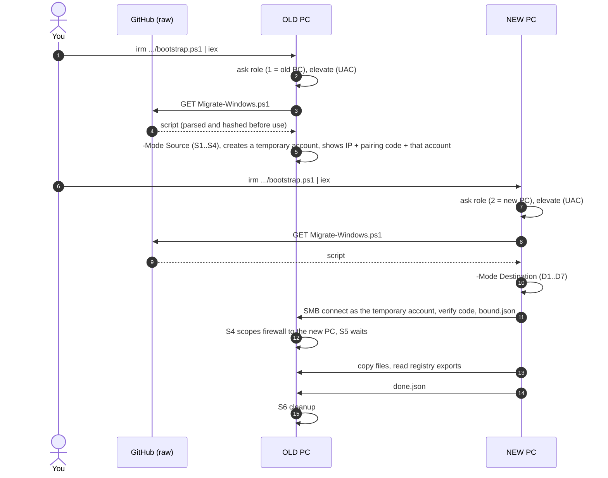
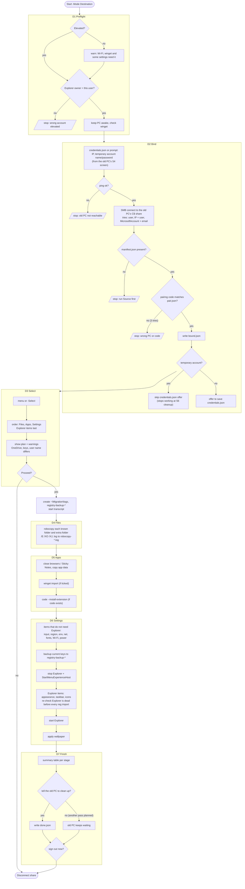
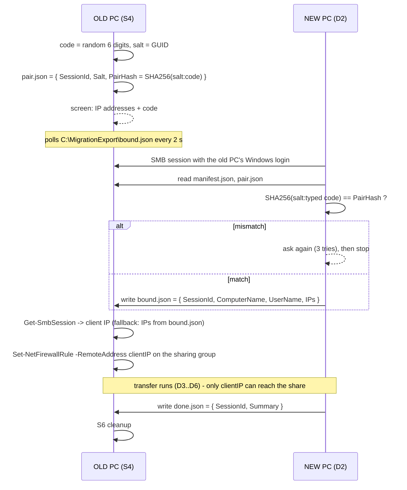
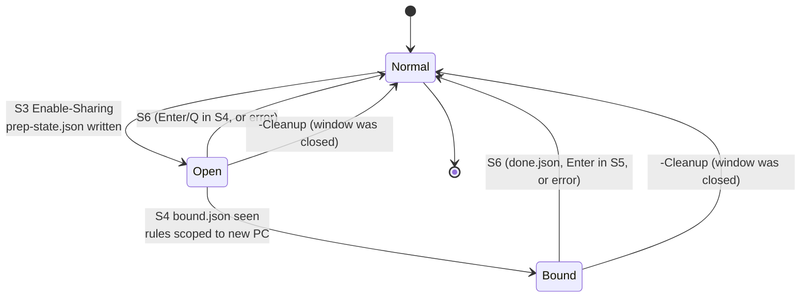

# Process

The tool is two cooperating programs: `Migrate-Windows.ps1 -Mode Source` on the old PC and `-Mode Destination` on the new PC, both normally started by `bootstrap.ps1`. Each side is a fixed sequence of stages. The stage code (S1..S6, D1..D7) is printed on screen and written to the transcript log, so problems can be pinned to a stage.

- [Getting the tool onto both PCs](#getting-the-tool-onto-both-pcs)
- [Old PC stages](#old-pc-stages)
  - [The temporary account](#the-temporary-account)
- [New PC stages](#new-pc-stages)
- [Binding handshake](#binding-handshake)
- [Sharing state on the old PC](#sharing-state-on-the-old-pc)
- [Files produced](#files-produced)

## Getting the tool onto both PCs



`bootstrap.ps1` only needs the network; the two copies of `Migrate-Windows.ps1` then talk to each other over SMB. Nothing is uploaded anywhere. By default the new PC signs in with a disposable account the old PC creates for this one run, not with either PC's real Windows or Microsoft account - see [the temporary account](#the-temporary-account).

## Old PC stages

```mermaid
flowchart TD
    A([Start -Mode Source]) --> S1
    subgraph S1["S1 Preflight"]
        direction TB
        P1{"Elevated?"} -- no --> X1[/"stop: run as administrator"/]
        P1 -- yes --> P2{"Explorer owner = this user?"}
        P2 -- no --> X2[/"stop: wrong account elevated"/]
        P2 -- yes --> P3["keep PC awake<br/>warn if known folders are in OneDrive"]
    end
    P3 --> S2
    subgraph S2["S2 Export to C:\MigrationExport"]
        direction TB
        E1["manifest.json: user, profile path, known folders, OS"]
        E2["reg folder: one .reg file per registry key, per catalog item"]
        E3["wifi folder: one .xml per network (key=clear)"]
        E4["apps-report.csv, apps.json (winget), vscode-extensions.txt"]
        E5["power.pow, wallpaper file"]
        E1 --> E2 --> E3 --> E4 --> E5
    end
    E5 --> S3
    subgraph S3["S3 Open sharing (recorded in prep-state.json)"]
        direction TB
        H0{"-UseOwnAccount?"} -- no --> H0a["create temporary local admin account<br/>random name + 24-char password"]
        H0 -- yes --> H1
        H0a --> H1["start Server service if stopped"] --> H2["enable firewall group<br/>File and Printer Sharing"]
        H2 --> H3["Public networks -> Private"] --> H4["LocalAccountTokenFilterPolicy = 1"]
    end
    H4 --> S4
    subgraph S4["S4 Pair"]
        direction TB
        R1["pair.json: salt + SHA256(salt:code)"] --> R2["show IP addresses + 6-digit code<br/>+ temporary account name/password (if created)"]
        R2 --> R3{"bound.json with<br/>matching SessionId?"}
        R3 -- "Enter / Q" --> CANCEL["cancelled"]
        R3 -- yes --> R4["resolve client IP (SMB session)"] --> R5["firewall rules RemoteAddress = that IP"]
    end
    R5 --> S5
    subgraph S5["S5 Wait"]
        W1{"done.json?"} -- "Enter" --> W2["finish early"]
        W1 -- yes --> W2
    end
    CANCEL --> S6
    W2 --> S6
    subgraph S6["S6 Cleanup (also: -Cleanup)"]
        C1["restore firewall rules (enabled state + addresses)"] --> C2["Private -> Public where it was Public"]
        C2 --> C3["restore / remove LocalAccountTokenFilterPolicy"] --> C4["stop Server service if we started it"]
        C4 --> C5["delete the temporary account, if one was created"] --> C6["delete C:\MigrationExport"]
    end
    C6 --> Z([Old PC unchanged])
```



| Stage | Changes on the old PC | Undo |
|---|---|---|
| S1 | none | |
| S2 | writes `C:\MigrationExport` (contains Wi-Fi passwords in clear text) | deleted in S6 |
| S3 | creates a temporary local administrator account unless `-UseOwnAccount`; firewall group enabled, network profile Private, `LocalAccountTokenFilterPolicy=1`, Server service started if it was stopped | S6 restores each from `prep-state.json`, including deleting the temporary account |
| S4 | firewall rules scoped to the new PC's IP | S6 restores the original addresses |
| S5 | none | |
| S6 | reverts S2 to S4 | |

### The temporary account

Stage S3 normally creates a local administrator account named `WTT-xxxxxxxx` with a random 24-character password, used for nothing except the SMB sign-in the new PC needs in D2. It is hidden from the normal sign-in screen, shown on screen in S4 next to the pairing code, and deleted again in S6 - it never touches your real account and does not need your Microsoft account password, which is the point: you may not have that password at all (lost, reset, or held by someone else on a work PC). The new PC does not offer to save it to `credentials.json`, because it stops working the moment this run ends. Pass `-UseOwnAccount` on the old PC to skip all of this and sign in with your own Windows account instead, as earlier versions of this tool required.

Any error after S1 jumps straight to S6, so sharing is never left open by an exception. If the window is closed, run `Migrate-Windows.ps1 -Cleanup` (elevated) or follow [manual.md](manual.md#reverting-the-sharing-changes-by-hand).

## New PC stages



| Stage | Changes on the new PC | Undo |
|---|---|---|
| D1 | none | |
| D2 | SMB connection to the old PC, normally as its temporary account; optional `credentials.json` next to the script (skipped for a temporary account) | connection removed at the end; delete the file |
| D3 | none | |
| D4 | files added to the profile folders. `/XO` means a newer file already on the new PC is never overwritten | delete what you do not want; `robocopy-*.log` lists every file |
| D5 | app data files, winget installs, VS Code extensions | uninstall; delete files |
| D6 | registry keys imported, Explorer restarted, wallpaper set | every imported key was exported first to `~\Migration\registry-backup-<time>\<item>\NN.reg`; double-click to restore |
| D7 | `done.json` on the old PC, optional sign-out | |

Dry runs (`-DryRun`) still bind and still print the plan, but robocopy runs with `/L`, no registry is touched, Explorer is left alone and no `done.json` is written, so the old PC keeps waiting for the real run.

## Binding handshake



What the code does and does not protect:

- It confirms the new PC is reading the export of the PC whose screen you are looking at, and lets the old PC learn which address to trust.
- It is not a secret by itself. Anyone who can already open `\\oldpc\C$` has a working credential - normally the temporary account's password, shown on the same screen. That password *is* the real secret for this run: anyone who reads it off the old PC's screen before you do can also connect.
- The firewall scope stops other machines reaching the sharing ports after binding. Between S3 and the moment of binding the share is open to the local subnet, as it is on any PC with sharing turned on.

## Sharing state on the old PC



`prep-state.json` is the single source of truth for the revert: firewall rule names with their original enabled state and remote addresses, the interfaces that were Public, the previous `LocalAccountTokenFilterPolicy` value, and whether the Server service was started by the tool.

## Files produced

Old PC, `C:\MigrationExport` (deleted in S6):

```
manifest.json            who, which profile, known-folder paths, OS, wallpaper file name
pair.json                salt + hash of the pairing code, SessionId
bound.json               written by the new PC in D2
done.json                written by the new PC in D7
prep-state.json          what S3/S4 changed, for S6
reg\<item>\NN.reg        registry exports per catalog item
wifi\*.xml               Wi-Fi profiles with clear-text keys
apps-report.csv          every installed program (from the Uninstall registry keys)
apps.json                winget export
vscode-extensions.txt    output of code --list-extensions
power.pow                active power plan
wallpaper.<ext>          copy of the current wallpaper
```

New PC, `%USERPROFILE%\Migration` (kept):

```
logs\transfer-<time>.log           PowerShell transcript of the run
logs\robocopy-<time>.log           every file robocopy touched or skipped
registry-backup-<time>\<item>\     the new PC's keys before import (double-click a .reg to restore)
old-pc-installed-apps.csv          the old PC's program list for manual installs
```
